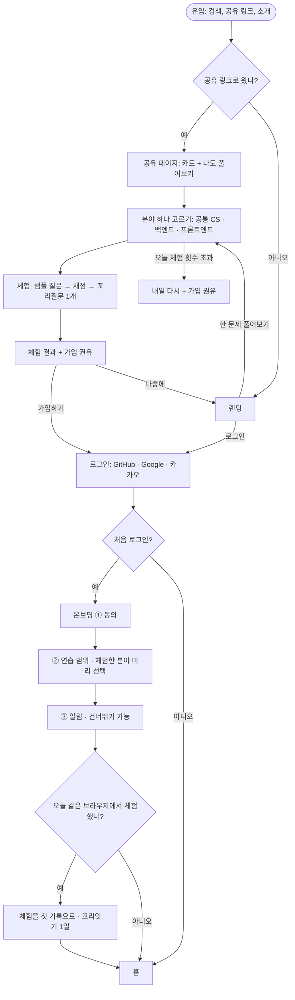
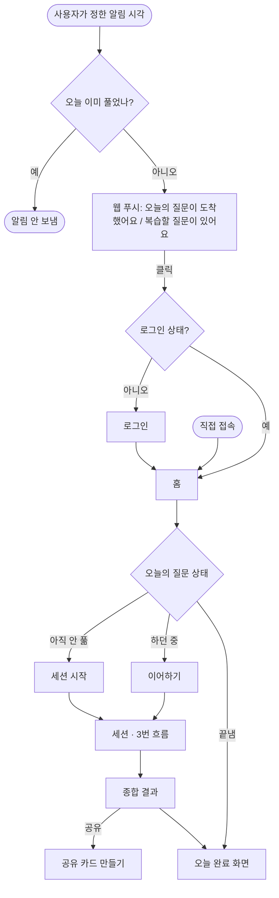
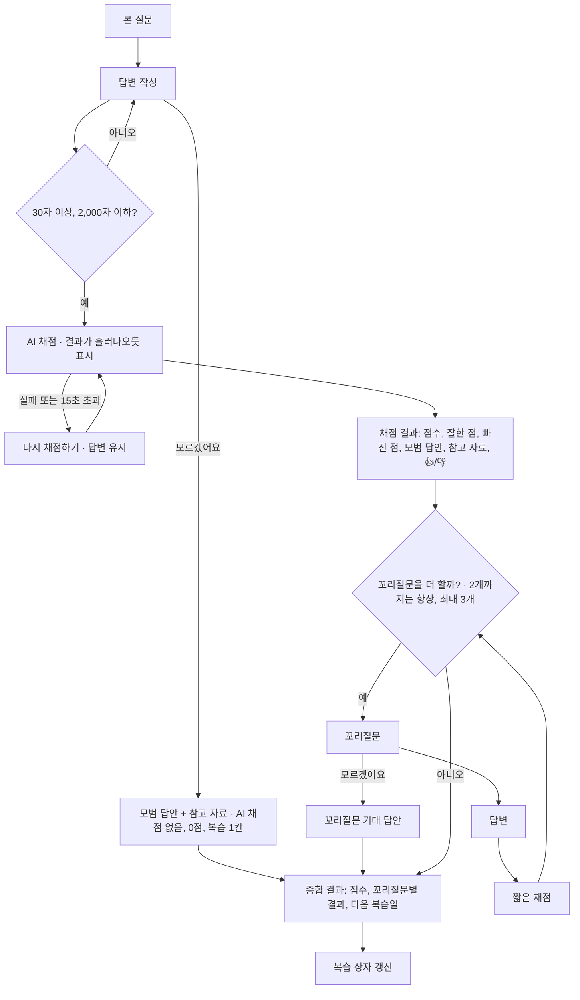
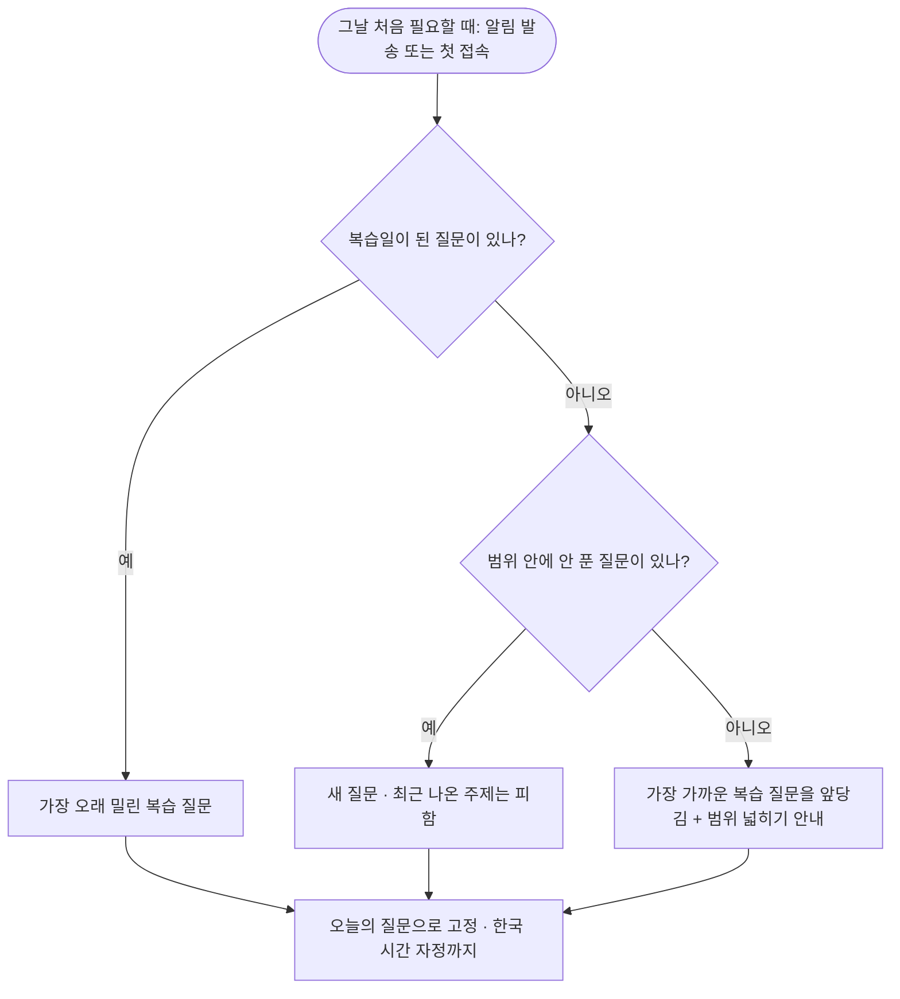
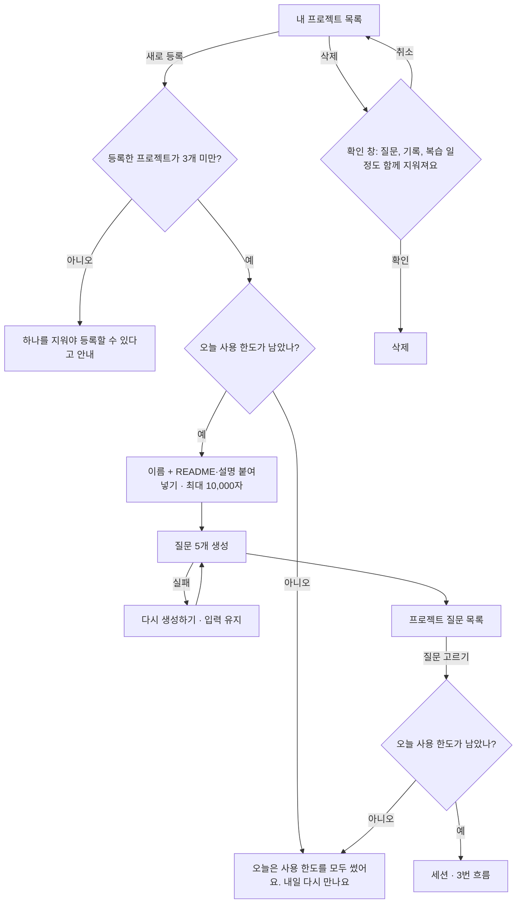
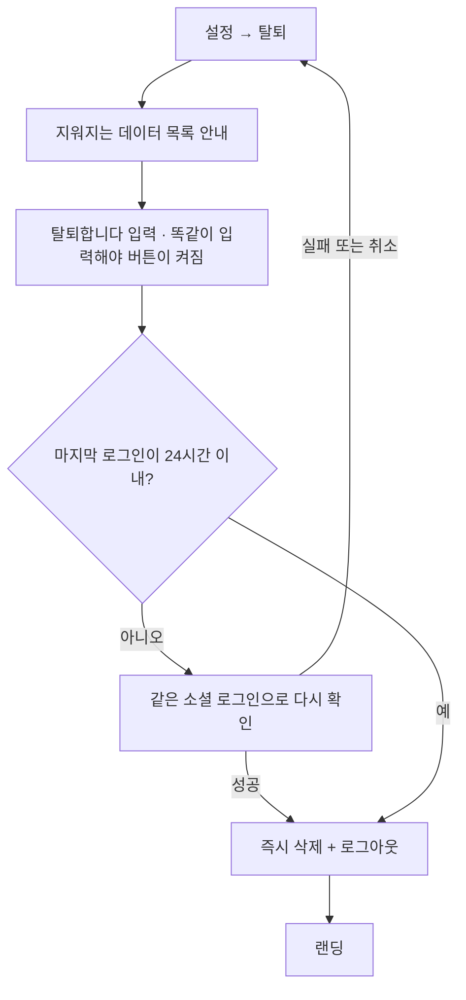

# 05. 사용자 흐름

[04 기능 명세](04-feature-spec.md)의 규칙을 사용자가 움직이는 순서로 그린다. 5단계 와이어프레임은 이 흐름의 화면들을 그린다. 다이어그램은 GitHub에서 그림으로 보인다.

## 1. 처음 온 사람

검색이나 공유 링크로 들어와서, 가입 전에 한 문제를 풀어보고, 가입과 온보딩을 거쳐 홈에 도착한다.

## 2. 매일 연습

알림이나 직접 접속으로 들어와 오늘의 질문 세션을 하고, 결과를 본 뒤 끝난다.

### 홈 화면의 세 가지 상태

| 상태 | 보이는 것 |
|---|---|
| 아직 안 풂 | 오늘의 질문 카드(복습이면 "복습"), 시작 버튼, 꼬리잇기 |
| 하던 중 | "이어서 하기"와 진행 단계(예: 꼬리질문 2/3) |
| 끝냄 | 오늘의 점수, 꼬리잇기, 다음 복습 예정, 기록·리포트·북마크 바로가기, "내일 아침 8시에 다음 질문이 와요"(알림 시각) |

## 3. 세션 (본 질문 + 꼬리질문)

- 사용 상한은 세션 **안에서** 확인하지 않는다. 오늘의 질문 세션은 항상 보장되고, 프로젝트 질문 세션은 시작하기 전에 확인한다(5번 흐름). 시작한 세션은 끝까지 할 수 있다.
- 세션은 **단계마다 저장**된다. 어느 단계에서 나가도 다시 들어오면 멈춘 곳부터 이어진다. 날짜가 바뀌면 본 질문을 제출하지 않은 세션은 끝나고, 제출한 세션의 남은 꼬리질문은 "건너뜀"으로 정리된다(04 기능 명세 4번). 처음엔 "날짜가 바뀌어도 이어갈 수 있다"였으나 놓친 날 규칙과 부딪혀 바꿨다.
- 채점 결과와 꼬리질문 화면에서 질문을 북마크할 수 있다.

## 4. 오늘의 질문 고르기

사용자에게 보이지 않는 흐름이다. 그날 처음 필요할 때(알림을 보낼 때나 첫 접속) 한 번 고르고 자정까지 고정한다.

내 프로젝트 질문도 부족했으면 복습 상자에 들어가므로, 복습일이 되면 이 흐름으로 오늘의 질문이 될 수 있다.

## 5. 내 프로젝트 기반 질문

## 6. 탈퇴

## 7. 예외 상황

| 상황 | 흐름 |
|---|---|
| 로그인이 필요한 화면에 로그인 없이 들어옴 | 로그인 → 원래 가려던 화면으로 돌아감 |
| 온보딩을 마치지 않고 나갔다 들어옴 | 온보딩의 멈춘 단계부터 |
| 알림 권한을 거부함 | 홈에 "알림을 켜면 매일 질문을 받아요" 배너. 브라우저 설정에서 켜는 방법 안내 |
| 아이폰에서 홈 화면에 추가하지 않고 알림을 켜려 함 | 홈 화면 추가 방법 안내 |
| 체험 횟수 초과 | 내일 다시 + 가입 권유 |
| 채점·질문 생성 실패 | 입력을 지우지 않고 다시 시도 버튼 |
| 오늘 사용 한도를 다 씀 (내 프로젝트) | 시작 버튼 대신 "오늘은 사용 한도를 모두 썼어요. 내일 다시 만나요". 오늘의 질문은 계속 풀 수 있다 |
| 서비스 월 예산 소진 | 모든 AI 기능의 시작 전에 같은 안내. 이미 시작한 세션은 끝까지 |
| 탈퇴한 사용자의 공유 링크 | 카드 대신 랜딩으로 |
