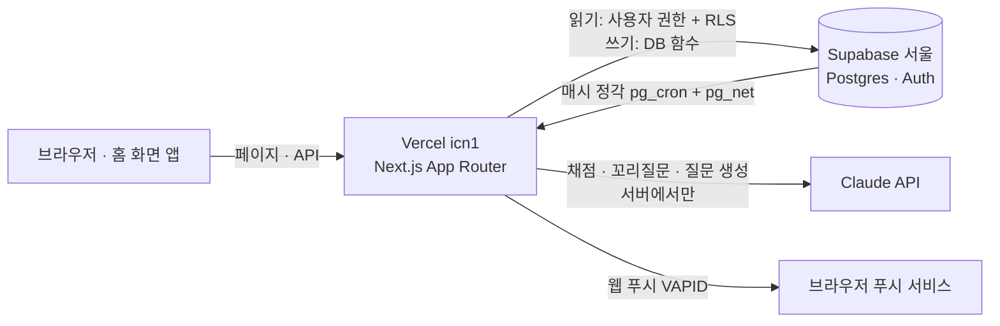
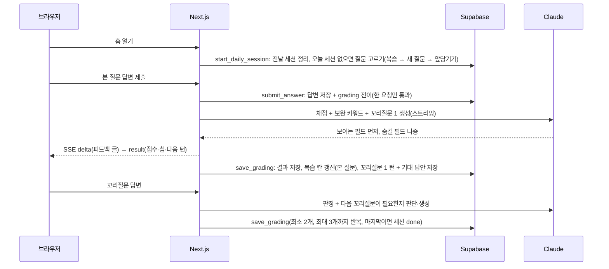
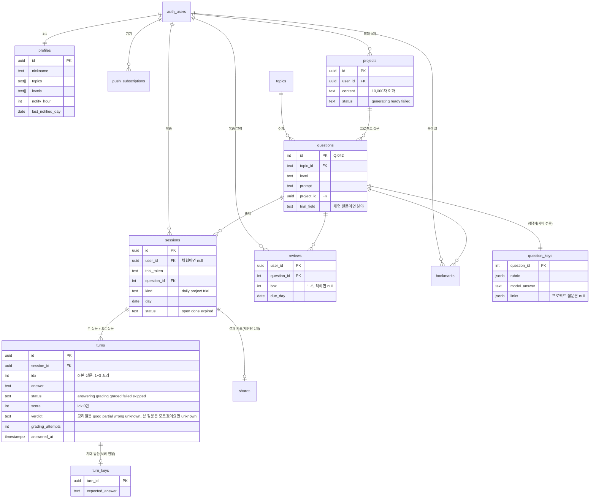

# 08. 아키텍처 · DB · API 설계

[04 기능 명세](04-feature-spec.md)를 어떤 구조와 데이터로 만들지 정한다. 채점 프롬프트와 점수 기준은 [#10](https://github.com/GREED-YI/tailq/issues/10), 개발 환경과 CI는 #11·#12에서 정한다.

2026-10-25에 설계 검토(#59)를 받아 고쳤다. 바꾼 곳은 그 자리에 "처음엔 … 바꿨다"로 남기고, [9장 검토 반영 표](#9-검토-반영-표)에 모았다.

## 1. 전체 구조



| 부분 | 맡는 일 |
|---|---|
| **Next.js (Vercel)** | 화면(서버 컴포넌트), API(Route Handler), 채점 스트리밍, 공유 카드 이미지(`next/og`), 웹 푸시 발송 |
| **Supabase** | 소셜 로그인(GitHub·Google·카카오), Postgres, 행 단위 접근 규칙(RLS), 규칙이 있는 쓰기를 묶는 DB 함수, 매시 알림 예약과 새벽 정리(`pg_cron`) |
| **Claude API** | 채점, 꼬리질문, 프로젝트 질문 생성. 키는 서버 환경변수에만 있다 |

### "서버"는 어디에 있나

따로 띄워 두는 백엔드 서버는 없지만 **서버에서 도는 코드는 있다.** Next.js의 Route Handler와 서버 컴포넌트는 브라우저가 아니라 Vercel의 컴퓨터에서 실행된다. Vercel은 요청이 올 때만 그 코드를 잠깐 실행하고(서버리스 함수), 우리는 서버를 켜 두거나 관리하지 않는다. 이 문서에서 "서버"는 이 코드를 말한다. API 키, 채점 규칙, 사용 한도 확인처럼 브라우저에 두면 안 되는 일을 여기서 한다.

### 실행 환경

처음엔 적지 않았으나, 기본값대로 두면 채점 스트리밍이 중간에 끊기고 DB 왕복이 느려서 적었다 (2026-10-25).

| 항목 | 값 | 이유 |
|---|---|---|
| Vercel 함수 리전 | `icn1`(서울). 무료 플랜도 리전 1개를 고를 수 있다 | 기본 `iad1`(미국 동부)이면 Supabase 서울까지 왕복 200ms쯤 걸려, 서버 컴포넌트가 3~4번 읽으면 1초가 간다 |
| Supabase 리전 | `ap-northeast-2`(서울) | 위와 같다 |
| 함수 실행 시간 | Fluid compute를 켠다(무료 플랜 최대 300초). 라우트마다 `export const maxDuration`을 적는다: 채점(`/api/turns/{id}/answer`) 60, 프로젝트 질문 생성·다시 생성(`/api/projects`, `/api/projects/{id}/generations`) 300. `after()`도 그 라우트의 `maxDuration`을 따른다 | Fluid compute가 꺼진 무료 플랜은 기본 10초라 채점(최대 15초)과 `after()` 저장이 끊긴다. 질문 5개 생성은 30~60초 넘게 걸릴 수 있다 |
| 런타임 | Node.js (Edge 아님) | `web-push`와 Anthropic SDK 스트리밍이 Node에서 돈다. 공유 카드 이미지(`next/og`)만 Edge |
| 스트리밍 중단 | Claude 호출에 브라우저의 `request.signal`을 넘기지 않는다 | 사용자가 떠나도 채점을 끝까지 받아 저장해야 한다 |
| 환경변수 | `ANTHROPIC_API_KEY`, `NEXT_PUBLIC_SUPABASE_URL`, `NEXT_PUBLIC_SUPABASE_ANON_KEY`, `SUPABASE_SERVICE_ROLE_KEY`, `VAPID_PUBLIC_KEY`·`VAPID_PRIVATE_KEY`·`VAPID_SUBJECT`, `CRON_SECRET`, `TRIAL_IP_HMAC_SECRET`, `AI_MONTHLY_BUDGET_USD`, `KRW_PER_USD`, `AI_MOCK` | 목록만 여기 두고 값·발급 방법은 #11. `NEXT_PUBLIC_` 둘만 브라우저에 간다 |

### 데이터 읽고 쓰는 길

브라우저에는 Supabase 공개 키와 로그인 토큰이 있으므로, 사용자 권한으로 할 수 있는 일은 브라우저에서도 직접 할 수 있다. 그래서 읽기와 쓰기를 나눈다.

- **읽기**: 서버 컴포넌트가 사용자 권한으로 읽는다. 테이블에는 **읽기(SELECT) 정책만** 두고 "자기 행만"을 RLS로 강제한다. 쓰기 정책이 없으므로 브라우저에서 직접 쓰는 길은 없다. 브라우저가 직접 읽어도 되는 곳(프로젝트 질문 생성 상태 폴링)은 같은 정책 아래 supabase-js로 읽는다.
  - **예외, 체험 화면**: 체험은 로그인 토큰이 없어 RLS로 읽을 수 없다. 서버가 쿠키의 체험 토큰으로 세션 소유를 확인한 뒤 `service_role`로 **그 세션과 턴만** 읽어 화면을 그린다. 다른 행을 읽는 코드 경로는 두지 않는다.
- **쓰기**: Route Handler가 먼저 로그인한 사용자를 확인한 뒤, 서버 전용 권한(`service_role`)으로 **DB 함수**(plpgsql)를 부른다. 함수 실행 권한은 `service_role`에만 준다(브라우저가 부를 수 없다).
- **DB 함수**는 Postgres 안에 저장해 두는 작은 프로그램이다. 여러 단계(확인 → 고르기 → 저장)를 DB 안에서 한 묶음으로 실행해서, 중간에 실패하면 전부 취소된다(은행 이체에서 출금과 입금이 같이 되거나 같이 안 되는 것과 같다). Next.js에서는 `supabase.rpc('함수이름')`으로 부른다.
- **DB 함수로 묶는 쓰기**: 여러 문장이 한꺼번에 성공하거나 실패해야 하는 것들이다. supabase-js에는 트랜잭션이 없어서 함수 안에서 묶는다. 같은 사용자의 요청이 동시에 와도 꼬이지 않게 함수 안에서 사용자별 잠금(`pg_advisory_xact_lock`)을 잡고, 유일 인덱스로 한 번 더 막는다. 함수 목록은 [3장 "DB 함수"](#db-함수)에 있다.

**함수 권한은 명시적으로 닫는다.** Postgres는 새 함수의 실행 권한을 기본으로 모두(`PUBLIC`)에게 주고, Supabase는 `public` 스키마의 함수를 브라우저 `rpc()`로 노출한다. 그래서 함수마다 마이그레이션에 아래 두 줄을 꼭 넣고, CI가 "anon·authenticated에 실행 권한이 있는 함수가 0개"인지 검사한다(6장). 처음엔 "service_role에만 준다"고만 적었으나, 기본값이 열려 있다는 것을 적지 않으면 그대로 열린 채 배포될 수 있어 보탰다 (2026-10-25).

```sql
revoke execute on function public.start_daily_session(uuid) from public, anon, authenticated;
grant execute on function public.start_daily_session(uuid) to service_role;
```

### 하루와 시간

- 날짜는 **한국 시간(KST) 기준 `date`**로, 시각은 `timestamptz`로 저장한다.
- "오늘"은 서버와 DB에서 `Asia/Seoul`로 계산한다(`(now() at time zone 'Asia/Seoul')::date`). 브라우저 시계를 믿지 않고, 날짜 열은 클라이언트에서 받지 않는다.
- **학습한 날**은 **오늘의 질문 세션**(`sessions.kind = 'daily'`, 이어받은 체험 포함)의 본 질문 답변을 제출한 시각(`turns.answered_at`)의 KST 날짜다. "모르겠어요"도 제출로 친다(04 기능 명세). 프로젝트 질문 세션은 학습한 날·잔디·꼬리잇기에 들어가지 않는다.
- **날짜를 넘긴 세션**: 다음 날 오늘의 질문 세션을 만드는 함수가 **`day < 오늘`인 열린 daily 세션 전부**를 정리한다(며칠 비웠어도 한 번에). 본 질문을 제출하지 않았으면 `expired`(놓친 날의 새 질문은 사라진다는 규칙. 복습 질문이었다면 복습 일정은 그대로 남아 다음에 다시 나온다). 본 질문을 제출했으면 `done`으로 닫고 남은 꼬리질문 턴은 `skipped`로 기록한다. 학습한 날과 복습 반영은 본 질문을 제출한 날에 이미 끝났으므로 잃는 것이 없다. 처음엔 "본 질문을 제출한 세션은 꼬리질문을 다음 날 이어갈 수 있다"였으나, 그러면 열린 세션이 둘(어제 꼬리질문 + 오늘 새 질문)이 되어 홈이 어느 것을 보여줄지 정해지지 않았다. 홈은 항상 세션 하나만 다루기로 바꿨다 (2026-10-25). 자정에 도는 크론은 없다. 정리는 다음 세션을 만들 때 같은 트랜잭션에서 한다. 자정 직전에 제출해 `grading` 중인 턴이 있으면 그 턴은 건드리지 않고 세션만 닫는다. `save_grading`은 세션이 이미 닫혀 있으면 결과와 복습 칸만 저장하고 다음 꼬리질문은 만들지 않는다.

## 2. 핵심 흐름

### 오늘의 질문 세션



- **꼬리질문은 하나씩 만든다.** 앞 답변을 채점하는 호출에서 다음 꼬리질문과 그 기대 답안을 함께 만든다. 그래서 2·3번째 꼬리질문도 바로 앞 답변을 바탕으로 하고(C-3), "모르겠어요"를 누르면 미리 만든 기대 답안을 보여주므로 AI를 다시 부르지 않는다. 2번째 꼬리질문을 채점할 때 "더 물을지"를 함께 받아 3번째를 만들지 정한다. 호출 수는 본 질문 1번 + 꼬리질문 2~3번이다.
- **꼬리질문은 점수 없이 판정**(`verdict`: good·partial·wrong·unknown)이고, 본 질문만 점수가 있다(07 UI 디자인, #10). 처음엔 good·partial·unknown 3단계였으나, 완전히 틀린 답도 "조금 부족해요"로 보여 잘못된 신호를 줘서 wrong(틀렸어요)을 더했다 (2026-10-26).
- **채점은 한 요청만 통과한다.** `submit_answer`가 턴을 `grading`으로 바꾸는데, `answering`·`failed`이거나 `grading`이 20초를 넘긴(멈춘) 경우에만 바뀐다. 같은 답변으로 여러 번 눌러도 AI는 한 번만 부른다.
- **시간 기준은 셋이다.** 서버의 Claude 호출 타임아웃 **15초**(넘으면 `failed`, 03 비기능 "15초 안에 끝난다"), 화면이 "다시 채점하기"를 보여주는 **15초**, 서버가 `grading`을 멈춘 것으로 보는 **20초**(타임아웃 뒤 저장까지의 여유). 처음엔 멈춤 판정이 30초였으나 화면의 15초와 15초나 벌어져 20초로 줄였다 (2026-10-25).
- **복습 칸은 본 질문 채점 때 갱신한다.** `save_grading`이 `idx = 0` 결과를 저장하면서 `reviews`를 옮기고, "모르겠어요"는 `submit_answer`가 0점·`unknown`으로 저장하면서 1칸에 넣는다. 처음 푼 새 질문을 잘 답하면 **2칸(3일 뒤)부터** 시작한다(04 기능 명세 5번). 처음엔 세션이 끝날 때(종합) 옮겼으나, 꼬리질문을 안 하고 나가면 영영 반영되지 않았다. 복습 일정은 본 질문 점수로만 정하므로(07) 앞당겨도 결과가 같다 (2026-10-25).
- **사용자가 떠나도 저장한다.** 스트리밍 응답과 별개로 결과 저장은 Next.js `after()`에서 끝까지 한다.
- **실패와 다시 채점**: 15초를 넘기거나 실패하면 답변은 그대로 두고 그 턴에 "다시 채점하기"를 보여준다. 다시 채점은 **같은 주소에 답변을 다시 PUT**하는 것이고(`turns.grading_attempts`가 1 늘어난다), 횟수는 하루 몇 번까지로 묶는다(숫자는 #10). 처음엔 `POST /api/turns/{id}/gradings`를 따로 두었으나, 하는 일이 같은 함수의 같은 전이여서 엔드포인트를 하나 줄였다 (2026-10-25).
- **이어하기**: 턴마다 저장하므로 나갔다 들어오면 멈춘 턴부터 이어간다. 프로젝트 질문 세션은 날짜가 바뀌어도 프로젝트 질문 목록에서 이어간다.

### 상태 전이표

처음엔 상태 이름만 있고 "누가 언제 바꾸는지"가 없어서, 자정 만료와 멈춘 채점을 처리하는 주체가 비어 있었다. 저장하는 상태와 읽을 때 계산하는 상태를 나눠 적었다 (2026-10-25).

**`sessions.status`**

| 전이 | 누가 | 조건 |
|---|---|---|
| (없음) → `open` | `start_daily_session`, `start_project_session`, `start_trial` | 오늘 daily 세션이 이미 있으면 그것을 돌려준다 |
| `open` → `done` | `save_grading` | 꼬리질문 3개를 마쳤거나 2번째 채점에서 "더 묻지 않음" |
| `open` → `done` | `submit_answer` | 본 질문 또는 꼬리질문에서 "모르겠어요" |
| `open` → `done` | `start_daily_session` | `day < 오늘`인 daily 세션이 본 질문을 제출한 채 열려 있음. 남은 `answering` 턴은 `skipped`, `grading` 턴은 그대로 둔다 |
| `open` → `expired` | `start_daily_session` | `day < 오늘`인 daily 세션이 본 질문을 제출하지 않음 |
| `open` → `done` | `adopt_trial` | 체험 세션을 이어받을 때 이미 끝난 세션이면 그대로, 꼬리질문 중이면 `done`으로 닫고 남은 턴은 `skipped` |

**`turns.status`**

| 전이 | 누가 | 조건 |
|---|---|---|
| (없음) → `answering` | 세션 시작(idx 0), `save_grading`(다음 꼬리질문) | |
| `answering`·`failed`·멈춘 `grading` → `grading` | `submit_answer` | 답변 저장, `grading_started_at = now()`, `grading_attempts + 1`, `answered_at`은 처음만 기록. 횟수 초과면 `REGRADE_LIMIT` |
| `grading` → `graded` | `save_grading` | 점수(idx 0)·판정·피드백·보완 키워드 저장. idx 0이면 복습 칸 갱신. 세션이 이미 닫혀 있으면 여기까지만 하고 다음 꼬리질문은 만들지 않는다 |
| `grading` → `failed` | `save_grading` | AI 호출 실패, 출력 검증 실패, 시간 초과 |
| `answering` → `graded` (`verdict = unknown`) | `submit_answer` | "모르겠어요". idx 0이면 `score = 0`, 복습 1칸. AI를 부르지 않는다 |
| `answering` → `skipped` | `start_daily_session`, `adopt_trial` | 전날 세션을 닫을 때 남은 꼬리질문 |
| `graded` → (변경 불가) | | 답변 PUT이 오면 `409 ALREADY_GRADED` + 현재 턴 상태 |

**읽을 때 계산하는 상태**: `status = 'grading'`이고 `grading_started_at < now() - interval '20 seconds'`이면 **멈춘 채점**이다. 화면에는 `failed`와 같이 "다시 채점하기"를 보여주고, `submit_answer`도 `failed`처럼 통과시킨다. 이 판단은 SQL 뷰 `turn_states`(턴 열 + `effective_status`) 하나에 두고 화면과 함수가 같은 뷰를 읽는다. 화면의 15초와 서버의 20초 사이에 "다시 채점하기"를 누르면 `409 GRADING_IN_PROGRESS`가 오는데, 화면은 버튼을 그대로 두고 현재 턴 상태를 다시 읽어 보여준다(이 5초 안에 원래 채점이 `graded`나 `failed`로 끝나 있으면 그것을 그린다). 20초가 지나면 둘 중 하나다: 결과가 저장돼 있거나(`graded`·`failed`), 멈춘 것이라 다시 채점이 통과한다. 어느 경우든 `graded`에 다시 채점이 오면 `409 ALREADY_GRADED`가 현재 상태를 돌려준다.

### 스트리밍 프로토콜

채점 응답은 **SSE**(`text/event-stream`)다. 처음엔 "스트리밍"이라고만 적었으나, 모델 출력 하나에 점수·피드백뿐 아니라 **다음 꼬리질문의 기대 답안**이 들어 있어 토큰을 그대로 흘리면 `turn_keys`에 숨기기 전에 브라우저로 나간다. 그래서 형식과 "무엇을 절대 보내지 않는지"를 적었다 (2026-10-25).

| 이벤트 | 데이터 | 언제 |
|---|---|---|
| `delta` | `{ text }` | 사용자에게 보이는 피드백 글(한 줄 평, 잘한 점, 보완할 점)이 생성되는 대로 |
| `result` | `{ turnId, status: "graded", score, verdict, feedback, missingKeywords, modelAnswer, links, nextTurn: { id, idx, prompt } \| null, session: { status, nextReviewDay } }` | 저장이 끝난 뒤 한 번 |
| `error` | `{ code, message }` | HTTP 200이 이미 나간 뒤 실패했을 때. 클라이언트는 "다시 채점하기"를 그린다 |

- 서버는 모델 출력을 **구조화 출력**(JSON 스키마)으로 받고 부분 파싱해서 보이는 필드만 `delta`로 전달한다. `expected_answer`는 어떤 이벤트에도 넣지 않고 `turn_keys`에만 저장한다.
- 모델에게 출력 순서를 **보이는 필드(피드백) 먼저, 숨길 필드(다음 꼬리질문·기대 답안) 마지막**으로 지시한다. 그러면 부분 파싱이 단순해진다. 프롬프트 쪽 규칙은 #10에 적는다.
- `missingKeywords`는 `question_keys.rubric.keywords`의 부분집합인지 서버가 검증하고 벗어난 것은 버린다(모델이 지어낸 키워드 차단). `score`는 0~100으로 자른다.
- "모르겠어요"는 AI를 부르지 않으므로 SSE 없이 보통 JSON으로 `result`와 같은 모양을 돌려준다.
- `result`에 **꼬리잇기는 없다.** 오늘의 결과 화면(07)은 세션이 끝난 뒤 서버 컴포넌트가 학습한 날을 다시 읽어 꼬리잇기·휴식권을 계산한다("꼬리잇기·잔디·휴식권" 절). 결과 화면은 SSE 응답이 아니라 페이지 이동으로 그린다.

### 모범 답안과 기대 답안 보호

모범 답안(`question_keys`)과 꼬리질문 기대 답안(`turn_keys`)은 **읽기 정책이 없는 서버 전용 테이블**에 둔다. 서버가 "이 세션에서 그 턴에 답했거나 모르겠어요를 눌렀는지" 확인한 뒤에만 꺼내서 채점 결과·기록 상세에 넣는다. 질문 본문·정답지 파일을 공개 저장소에 두지 않는 이유와 보관 위치는 [5장](#5-콘텐츠-저장-위치와-반영-절차)에 있다.

### 웹 푸시

1. 사용자가 알림을 켜면 브라우저 구독 정보(endpoint, 키)를 `push_subscriptions`에 저장한다.
2. Supabase `pg_cron`이 **매시 정각** `pg_net`으로 `POST /api/cron/push`를 부른다. 비밀 헤더 값은 `vault.secrets`에 두고 `cron.schedule` 문장에 직접 쓰지 않는다. 이 API는 바로 응답하고, 발송은 `after()`에서 한다(`pg_net` 요청 시간 제한 때문).
3. 대상은 `notify_on`이고 `notify_hour`가 지금 KST 시각이며, **`last_notified_day < 오늘`**이고 **오늘 본 질문을 아직 제출하지 않은 사람**이다. 대상을 고르면서 같은 문장으로 `last_notified_day = 오늘`을 적어(`update … returning`) 핸들러가 두 번 돌아도 두 번 보내지 않는다. 처음엔 이 열이 없어 `pg_net` 재시도나 배포 중 겹침으로 중복 발송될 수 있었다 (2026-10-25).
4. 문구는 세션을 만들지 않고 정한다. `reviews`에 `due_day <= 오늘`인 행이 있으면 "복습할 질문이 있어요", 없으면 "오늘의 질문이 도착했어요". 처음엔 "알림 보낼 때 질문을 고른다"(05)였으나, 매시 사용자마다 세션을 만들면 비용과 복잡도만 늘어서 복습 여부만 본다. 질문은 첫 접속 때 고른다 (2026-10-25).
5. `web-push`(VAPID)로 20개씩 `Promise.allSettled`로 보낸다. 410·404 응답이 오면 구독을 지운다.

Vercel 무료 플랜의 크론은 하루 한 번만 돌아서 "1시간 단위로 고르는 알림 시각"을 맞출 수 없다. 이 호출은 매시 Supabase REST API를 1번 이상 치므로 무료 Supabase가 일주일 쉬면 멈추는 문제(#20)도 함께 막는다. **확인 필요**: Supabase의 정지 판단은 API 게이트웨이 요청 기준이라 `pg_cron`이 DB 안에서 도는 것만으로는 안 된다. 대상이 0명인 시각에도 핸들러가 조회 1번은 하도록 만든다.

### 체험과 이어받기

- 체험을 시작하면 무작위 토큰을 `httpOnly` 쿠키에 넣고, **일반 세션과 같은 `sessions`·`turns`에** `user_id` 없이 `trial_token`으로 저장한다. 꼬리질문 1개까지 같은 흐름을 쓰고 API도 같은 `PUT /api/turns/{id}/answer`를 쓴다(소유 확인만 쿠키 토큰으로).
- **하루 제한**: 같은 브라우저(쿠키 토큰으로 오늘 세션이 있으면) 1번, **같은 IP는 하루 20번**까지. 둘 다 `start_trial` 함수 안에서 `count`로 검사한다. IP는 서버 비밀값으로 HMAC을 씌워 `ip_hash`에 저장한다(그냥 해시하면 IP를 되찾을 수 있다). 처음엔 `(ip_hash, day)` 유일 인덱스로 IP도 1번이었으나, 부트캠프 강의실·회사처럼 한 공인 IP를 수백 명이 쓰는 곳에서 첫 사람 뒤로 전원이 막혔다. 타깃 사용자가 바로 그곳에 있어서 바꿨다 (2026-10-25, 04 기능 명세도 같이 고쳤다).
- 이어받기(`adopt_trial`): 로그인 직후, **처음 가입한 사용자이고, 쿠키의 체험 세션이 `day = 오늘(KST)`이고, 오늘 daily 세션이 없을 때만** 그 체험 세션을 `user_id` 채움, `kind = 'daily'`, `pick = 'new'`, `trial_token = null`, `ip_hash = null`로 바꾼다. 꼬리질문 중이면 `done`으로 닫고 남은 턴은 `skipped`. 본 질문 결과로 `reviews`를 만든다. 그 세션이 오늘의 질문으로 인정되어 꼬리잇기 1일과 복습 칸이 반영된다. 이미 계정이 있던 사람은 이어받지 않는다. 처음엔 "`user_id`를 채운다"고만 적었으나 `kind`를 바꾸지 않으면 `(user_id, day) where kind = 'daily'` 유일 인덱스가 걸리지 않아 같은 날 세션이 하나 더 생기고, `ip_hash`가 가입자 세션에 남았다 (2026-10-25).
- **이어받지 않은 체험은 다음 날 새벽(매일 4시 KST, `pg_cron`)에 지운다.** 이어받기는 체험한 날에만 되므로 하루 넘게 둘 이유가 없다. 지우는 것은 체험 세션과 답변 전체이고, 비용 합계용 `ai_usage` 행만 남는다(개인 내용 없음). 이 정리는 DB 안에서 SQL로만 하고 API를 부르지 않는다.

### 하루 사용 한도와 월 예산

- 세션이나 프로젝트 질문 생성을 **시작할 때** 필요한 몫을 `ai_usage`에 `reserved`로 예약하고, 실제로 쓰면 `used`와 토큰·비용으로 바꾼다. 확인과 예약은 시작 함수(`start_project_session`, `create_project`) 안에서 잠금을 잡고 한다.
- `ai_usage`는 프로젝트·세션과 외래키로 묶지 않는다. 프로젝트를 지웠다 다시 만들어도 그날 쓴 양이 줄지 않는다.
- 오늘의 질문 1세션은 개인 한도와 상관없이 보장한다(다시 채점 횟수만 따로 묶는다).
- 비용은 **달러**(`cost_usd`)로 저장하고 원화는 보여줄 때 `KRW_PER_USD`(환경변수, 고정 환율)로 환산한다. 처음엔 `cost_krw`였으나 환율이 끼면 나중에 다시 계산할 수 없다 (2026-10-25).
- 이번 달(KST) 합계가 월 예산(`AI_MONTHLY_BUDGET_USD`, $20)에 닿으면 새로 시작하는 AI 기능을 모두 막는다. 이미 시작한 세션은 끝까지 한다. 처음엔 `AI_MONTHLY_BUDGET_KRW`(1만 원)였으나, 비용을 달러로 저장하므로 예산도 달러로 두어 환율 없이 비교하고, 금액을 $20으로 올렸다 (2026-10-26).
- 합계가 예산의 80%를 넘으면 **세션을 시작할 때** 본 질문 채점 모델을 Haiku로 정해 세션에 저장한다(세션 중간에 모델이 바뀌지 않는다). 기본은 본 질문 Sonnet, 꼬리질문 Haiku다([09 채점](09-grading.md) 5장).
- 숫자(프로젝트 하루 몇 회, 다시 채점 몇 회, 세션당 예약 몫)는 #10에서 호출당 비용을 잰 뒤 정한다.

### 내 프로젝트 질문 생성

처음엔 `POST /api/projects`가 등록과 질문 5개 생성을 한 요청에서 끝냈으나, 질문 5개와 각 루브릭·모범 답안은 출력이 2~4천 토큰이라 30~60초가 걸려 함수 시간 안에 끝난다고 보기 어렵고, 실패하면 "입력 유지"할 행이 없었다. 상태를 두고 뒤에서 만들기로 바꿨다 (2026-10-25).

1. `POST /api/projects` → `create_project`: 3개 제한·한도 확인·예약 후 `projects`를 `status = 'generating'`으로 저장하고 **바로 응답**한다.
2. 생성은 `after()`에서 한다(이 라우트와 다시 생성 라우트는 `maxDuration = 300`, 1장 "실행 환경"). 끝나면 `save_project_questions`가 `questions`(`project_id`, `topic_id`·`level` 없음) 5개와 `question_keys`(`rubric`, `model_answer`, `links`는 null) 5개를 한 트랜잭션으로 넣고 `status = 'ready'`. 실패하면 `status = 'failed'`, `error_code`.
3. 화면은 `projects` 행을 2초마다 읽어(RLS 읽기 정책 안에서 supabase-js) 상태를 본다. Supabase Realtime으로 바꿔도 되지만 처음엔 폴링으로 충분하다.
4. 다시 생성은 `POST /api/projects/{id}/generations`. `failed`일 때만 받고 한도는 다시 예약하지 않는다(처음 예약한 몫을 쓴다).
5. 프로젝트 질문에는 참고 자료 링크를 넣지 않는다. 모델이 만든 URL은 없는 주소일 수 있다.

### 꼬리잇기·잔디·휴식권

따로 저장하지 않고 **읽을 때 계산한다.** 학습한 날(daily 세션의 본 질문 제출일) 목록을 1년 치 읽어서, 하루 빈 날을 그 주(월~일)의 휴식권으로 메울 수 있으면 휴식일로 표시하고 이어간다. 사용자당 최대 366일이라 계산이 가볍고, 따로 저장했을 때 생기는 어긋남이 없다. 계산은 순수 함수 하나로 만들고 테스트로 지킨다. 잔디 색은 그날 본 질문 점수다.

홈의 3칸 통계(07)도 저장하지 않고 읽을 때 계산한다. "다시 나올 질문"은 `reviews`에서 `due_day <= 오늘`인 수, "약한 주제"는 약점 리포트(04 §6)와 같은 기준으로 **3번 이상 푼 세부 주제 중 본 질문 평균 점수가 가장 낮은 것**이고, 그런 주제가 없으면 칸을 비운다("데이터가 모이는 중").

## 3. DB 테이블

`auth.users`는 Supabase가 관리한다. 아래는 `public` 테이블이다. 모든 테이블에 RLS를 켜고 쓰기 정책은 두지 않는다. 읽기 정책은 이렇다.

| 테이블 | 읽기 정책 |
|---|---|
| `profiles` | `id = auth.uid()` |
| `push_subscriptions`, `sessions`, `reviews`, `bookmarks`, `projects` | `user_id = auth.uid()` |
| `turns` | 세션을 거친다: `exists (select 1 from sessions s where s.id = turns.session_id and s.user_id = auth.uid())` |
| `questions` | 내 세션·복습·북마크·프로젝트의 질문만("질문" 절) |
| `topics` | 로그인한 사람 누구나 |
| `question_keys`, `turn_keys` | 정책 없음. 서버 전용, 서버가 조건을 확인한 뒤 `service_role`로 읽는다 |
| `shares`, `ai_usage`, `events` | 정책 없음. 서버만 읽고 쓴다(공유 페이지는 서버가 `id`로 읽는다) |



그림에는 관계가 있는 테이블만 그렸다. `ai_usage`(AI 사용량)와 `events`(지표)는 일부러 다른 테이블과 외래키로 묶지 않아서 그림에서 뺐다(프로젝트를 지워도 사용량이 남아야 하고, 지표는 따로 쌓는다). 열은 아래 표에 있다.

### 질문

| 테이블 | 주요 열 | 메모 |
|---|---|---|
| `topics` | `id`(예: `jpa`), `field`(cs·backend·frontend), `name`, `sort` | 기능 명세의 세부 주제 15개 |
| `questions` | `id`(정수), `topic_id`, `level`(basic·mid·deep), `prompt`, `is_hidden`, `project_id`, `trial_field`(cs·backend·frontend, 체험 샘플 질문이면 그 분야. 보통은 null) | 질문 은행과 프로젝트 질문을 한 테이블에. 체험은 분야마다 `trial_field`가 그 분야인 질문 1개를 낸다(`start_trial`). 화면의 `Q.042`는 은행 질문의 `id`다(프로젝트 질문은 "내 프로젝트"로 표시). 프로젝트 질문은 `topic_id`·`level`이 없고 약점 리포트·연습 범위에서 빠진다 |
| `question_keys` | `question_id`, `rubric`(jsonb), `model_answer`, `links`(공식 문서 링크 1~3개, jsonb, 프로젝트 질문은 null) | 서버 전용(읽기 정책 없음). 처음엔 `references`였으나 SQL 예약어라 모든 쿼리에 따옴표가 필요해서 바꿨다 (2026-10-25) |

**`questions` 읽기 정책**: "내 세션·복습·북마크에 있는 질문, 또는 내 프로젝트의 질문"만 읽는다.

```sql
exists (select 1 from sessions s where s.question_id = questions.id and s.user_id = auth.uid())
or exists (select 1 from reviews r where r.question_id = questions.id and r.user_id = auth.uid())
or exists (select 1 from bookmarks b where b.question_id = questions.id and b.user_id = auth.uid())
or exists (select 1 from projects p where p.id = questions.project_id and p.user_id = auth.uid())
```

처음엔 "은행 질문은 로그인한 사람 누구나"였으나, 그러면 공개 키와 로그인 토큰으로 질문 150개를 한 번에 내려받을 수 있었다. 질문 고르기는 `service_role` 함수가 하므로 정책을 좁혀도 영향이 없다 (2026-10-25). 홈·복습·기록·북마크·프로젝트 화면이 읽는 질문은 모두 위 넷 중 하나에 들어 있다.

### 사용자

| 테이블 | 주요 열 | 메모 |
|---|---|---|
| `profiles` | `id`(= `auth.users.id`), `nickname`(2~12자), `avatar`(소셜 사진 URL 또는 기본 아바타 키), `topics`(text[]), `levels`(text[]), `notify_on`, `notify_hour`(0~23, 기본 8), `last_notified_day`(중복 발송 방지), `theme`(system·light·dark), `agreed_at`, `onboarded_at`, `created_at` | 연습 범위는 배열 열로 충분하다. 행은 `auth.users`에 사용자가 생길 때 트리거(`handle_new_user`, `security definer`)가 만든다. 첫 로그인 판단은 `onboarded_at is null` |
| `push_subscriptions` | `id`, `user_id`, `endpoint`(유일), `p256dh`, `auth_key`, `created_at` | 기기마다 하나. 처음엔 `auth`였으나 Supabase 스키마 이름과 겹쳐 바꿨다 (2026-10-25) |

### 학습

| 테이블 | 주요 열 | 메모 |
|---|---|---|
| `sessions` | `id`, `user_id`(체험이면 null), `trial_token`, `ip_hash`(체험 IP의 HMAC, 이어받으면 null), `question_id`, `kind`(daily·project·trial), `pick`(review·new·advance), `day`, `status`(open·done·expired), `created_at`, `completed_at` | 유일 인덱스 `(user_id, day) where kind = 'daily'`. 점수는 `turns`에 있다(세션 점수 = 본 질문 턴의 점수). `pick`은 "복습" 표시와 "새 질문을 다 풀었어요" 안내를 다시 그리는 데 쓴다 |
| `turns` | `id`, `session_id`, `idx`(0 = 본 질문, 1~3 = 꼬리질문), `follow_up_prompt`(꼬리질문 글, 본 질문 턴은 비어 있고 글은 `questions`에 있다), `answer`, `status`(answering·grading·graded·failed·skipped), `grading_started_at`, `grading_attempts`(다시 채점 횟수 제한), `answered_at`, `score`(idx 0만), `verdict`(꼬리질문은 good·partial·wrong·unknown 판정, 본 질문은 "모르겠어요"일 때만 unknown이고 그 외는 null), `feedback`(jsonb), `rating`(👍 1 / 👎 -1) | 유일 `(session_id, idx)`. CHECK: `idx = 0`이면 `verdict`가 `unknown`이거나 null이고 `graded`면 `score`가 있다, `idx > 0`이면 `score`가 null |
| `turn_keys` | `turn_id`, `expected_answer` | 꼬리질문 기대 답안. 서버 전용 |
| `reviews` | `user_id`, `question_id`, `box`(1~5, 익히면 null), `due_day` | PK `(user_id, question_id)`. 사용자에게는 칸 대신 다음 복습일·숙련도로 보여준다. 갱신은 본 질문 채점 때 |
| `bookmarks` | `user_id`, `question_id`, `created_at` | PK `(user_id, question_id)` |
| `projects` | `id`, `user_id`, `name`, `content`(10,000자 이하), `status`(generating·ready·failed), `error_code`, `created_at` | 사용자당 3개. 지우면 그 질문·세션·복습이 함께 지워진다(`on delete cascade`). **오늘의 daily 세션이 이 프로젝트의 질문이면 그날은 지울 수 없다**(`delete_project`가 거부, 화면은 "오늘의 질문으로 나온 프로젝트는 내일 지울 수 있어요"). 처음엔 제한이 없었으나 cascade로 오늘 세션과 학습한 날이 사라지고 새 세션이 하나 더 만들어졌다 (2026-10-25) |

### jsonb 스키마

처음엔 "잘한 점·보완할 점"처럼 내용만 적었으나, 07 UI 디자인의 "보완할 개념" 칩과 #10의 `missing_keywords`를 어디에 두는지 프런트·프롬프트·테스트 픽스처가 각자 정하지 않게 모양을 고정했다 (2026-10-25). 서버는 zod 스키마 하나로 모델 출력과 저장값을 모두 검증한다.

| 열 | 모양 |
|---|---|
| `question_keys.rubric` | `{ "keywords": string[], "criteria": string[] }` — `keywords`는 보완할 개념 칩의 후보, `criteria`는 채점 기준 문장 |
| `question_keys.links` | `[{ "title": string, "url": string }]` 1~3개. 프로젝트 질문은 null |
| `turns.feedback` | `{ "summary": string, "good": string[], "improve": string[], "missing_keywords": string[], "criteria": { "concept": int, "reason": int, "application": int, "delivery": int } }` — `missing_keywords ⊆ rubric.keywords`를 서버가 검증. `good`은 0~3개(빈 배열이면 화면에서 잘한 점 줄을 숨긴다). `criteria`는 본 질문의 기준별 점수로 저장만 하고 화면에는 보여주지 않는다(약점 리포트용). 꼬리질문 턴은 `summary`만 있어도 된다. 처음엔 `criteria`를 둘 곳이 없었다 (2026-10-26) |
| `events.props` | 1KB 이하의 평평한 객체. 이름별 허용 키는 지표 이슈에서 정한다 |

### 공유 · 운영

| 테이블 | 주요 열 | 메모 |
|---|---|---|
| `shares` | `id`(짧은 무작위 문자열), `session_id`(유일), `nickname`(뺄 수 있음), `topic_name`(프로젝트 질문이면 "내 프로젝트"), `score`, `streak`, `created_at` | daily·project 세션 모두 공유할 수 있다. 읽기 정책 없음. 공유 페이지는 서버가 `id` 하나로만 읽고 누구의 세션인지는 내보내지 않는다. 만들 때는 `session_id`만 받고 점수·꼬리잇기는 서버가 계산한다(위조 방지). 세션당 하나라 다시 누르면 기존 카드를 돌려준다 |
| `ai_usage` | `id`, `user_id`(체험이면 null), `purpose`(grade·follow_up·project_gen·trial), `status`(reserved·used·released·failed), `error_code`, `latency_ms`, `input_tokens`, `output_tokens`, `cost_usd`, `day`, `created_at` | 개인 하루 한도, 서비스 월 예산, 그리고 **AI 실패율·지연 관측**(7장) |
| `events` | `id`, `name`, `user_id`, `anon_id`, `props`(jsonb), `created_at` | 지표 이벤트(첫 방문, 체험 시작·완료, 가입, 세션 시작, 본 질문 제출, 세션 완료, 👍/👎, 공유, 알림 클릭). 서버만 쓴다. 비로그인도 보낼 수 있는 입구라 이름은 허용 목록만, `props`는 1KB까지, `anon_id`당 하루 200건을 넘으면 버린다. 90일 지난 행은 새벽 정리에서 지운다 |

### DB 함수

쓰기는 모두 아래 함수를 거친다. 전부 `service_role`만 실행할 수 있다(1장).

| 함수 | 하는 일 |
|---|---|
| `start_daily_session(user_id)` | 사용자 잠금 → 전날 열린 daily 세션 정리(`expired` 또는 `done` + `skipped`) → 오늘 세션이 있으면 반환, 없으면 질문 고르기(복습 → 새 질문 → 앞당기기) + 세션·턴 0 생성 |
| `start_project_session(user_id, question_id)` | 주인 확인, 월 예산·하루 한도 확인과 예약, 세션·턴 0 생성 |
| `start_trial(trial_token, ip_hash, field)` | 브라우저 1번·IP 20번 확인, `trial_field = field`인 샘플 질문으로 세션 생성 |
| `submit_answer(turn_id, owner, text \| dont_know)` | 소유 확인(사용자 또는 체험 토큰), 상태 전이(`grading` 또는 `unknown`), 다시 채점 횟수, 모르겠어요면 복습 1칸·세션 종료 |
| `save_grading(turn_id, result)` | 결과 저장, idx 0이면 복습 칸 갱신, 다음 꼬리질문 턴 + `turn_keys` 생성 또는 세션 종료(세션이 이미 닫혔으면 결과만 저장), `ai_usage`를 `used`/`failed`로 |
| `create_project(user_id, name, content)` | 3개 제한, 예산·한도 확인과 예약, `generating`으로 저장 |
| `save_project_questions(project_id, questions)` | 질문 5개 + 정답지 저장, `ready`. 실패면 `failed` + `error_code` |
| `delete_project(user_id, project_id)` | 오늘 daily 세션이 이 프로젝트 질문이면 거부, 아니면 삭제(cascade) |
| `adopt_trial(user_id, trial_token)` | 이어받기(2장) |
| `handle_new_user()` | `auth.users` insert 트리거. `profiles` 행 생성(닉네임·아바타는 소셜 메타데이터에서) |

### 탈퇴

1. 마지막 로그인이 24시간보다 오래됐으면 같은 소셜 로그인으로 다시 확인한다. 로그인 토큰의 인증 시각(`amr`)으로 재고, 돌아온 사용자 id가 같은지 확인한다(다른 방법으로 로그인하면 다른 계정이 생기므로). 재인증은 `GET /auth/callback?next=/my/delete`로 돌아온다.
2. `DELETE /api/me`가 서버 전용 권한으로 `auth.users`의 그 사용자를 지운다. 사용자 테이블은 모두 `on delete cascade`로 이어져 답변·채점·프로젝트·알림 구독·공유가 한 번에 지워진다.
3. 그 사용자의 `events`(같은 브라우저의 `anon_id` 이벤트 포함)도 지운다. `ai_usage`는 `user_id`만 비워 비용 합계를 남긴다(답변 같은 개인 내용은 없다).
4. 이미 발급된 로그인 토큰이 만료 전까지 살아 있으므로 바로 로그아웃시키고 랜딩으로 보낸다.

## 4. API (Route Handler)

화면에 필요한 읽기는 서버 컴포넌트가 바로 하므로, API는 쓰기와 스트리밍, 외부 호출만 둔다. 쓰기는 모두 3장의 DB 함수를 거친다.

**REST 방식으로 짠다.** 주소는 "무엇(자원)"을 가리키는 명사로, 하는 일은 HTTP 메서드로 나타낸다. 생성은 `POST`, 통째로 바꾸기·덮어쓰기는 `PUT`, 일부만 바꾸기는 `PATCH`, 지우기는 `DELETE`. "모르겠어요"처럼 동사로 보이는 것도 자원으로 바꿔 표현한다(모르겠어요 = 답변의 한 종류).

| 메서드 · 경로 | 하는 일 | 로그인 |
|---|---|---|
| `GET /auth/callback?next=` | 소셜 로그인 돌아오는 곳(Supabase 규칙). 체험 이어받기, 첫 로그인이면 온보딩으로, `next`가 있으면 그곳으로(탈퇴 재인증) | - |
| `PATCH /api/me` | 내 프로필·설정 바꾸기(닉네임, 아바타, 연습 범위, 알림 켜기·시각, 테마, 온보딩 동의) | ○ |
| `DELETE /api/me` | 탈퇴 | ○ |
| `POST /api/sessions` | 세션 만들기. `{ kind: "daily" }`면 오늘의 세션(이미 있으면 그것을 돌려줌), `{ kind: "project", questionId }`면 프로젝트 질문 세션(한도 예약) | ○ |
| `PUT /api/turns/{id}/answer` | 답변 저장 → 채점 + 다음 꼬리질문(SSE). `{ text }` 또는 `{ dontKnow: true }`(AI를 부르지 않음, JSON 응답). 실패한 턴에 같은 요청을 다시 보내면 다시 채점이다. 체험 턴도 같은 주소(쿠키 토큰으로 소유 확인) | ○ 또는 체험 쿠키 |
| `PUT /api/turns/{id}/rating` | 👍/👎 | ○ |
| `PUT /api/bookmarks/{questionId}` · `DELETE` | 북마크 저장·해제 | ○ |
| `POST /api/projects` | 프로젝트 등록(한도 예약) → `generating`으로 바로 응답. 질문 생성은 뒤에서 | ○ |
| `POST /api/projects/{id}/generations` | 실패한 프로젝트의 질문 다시 생성 | ○ |
| `DELETE /api/projects/{id}` | 프로젝트와 딸린 질문·기록 삭제. 오늘의 질문이면 `409 PROJECT_IN_TODAY_SESSION` | ○ |
| `POST /api/push-subscriptions` · `DELETE /api/push-subscriptions/{id}` | 알림 구독·해제 | ○ |
| `POST /api/shares` | 결과 공유 카드 만들기(`sessionId`만 받음). 이미 있으면 그것을 돌려줌 | ○ |
| `POST /api/trial-sessions` | 체험 시작(브라우저 1번, IP 하루 20번) | ✕ |
| `POST /api/events` | 지표 이벤트(허용 목록·크기·개수 제한) | ✕ |
| `POST /api/cron/push` | 매시 알림 발송(`pg_cron` 전용, 비밀 헤더). 외부에 공개하는 API가 아니라 예약 작업이 부르는 내부 입구 | 비밀값 |

처음엔 `PUT /api/trial-sessions/current/turns/{idx}/answer`(체험)와 `POST /api/turns/{id}/gradings`(다시 채점)가 따로 있었으나, 체험 턴도 같은 `turns`에 있고 다시 채점도 같은 상태 전이라 둘 다 `PUT /api/turns/{id}/answer`로 합쳤다. 스트리밍 코드가 한 벌이 된다 (2026-10-25).

페이지 쪽: `/s/{id}` 공유 페이지와 그 미리보기 이미지(`opengraph-image`, `next/og`).

### 에러 형식

HTTP 상태 코드에 더해 본문은 항상 `{ "error": { "code", "message" } }`다. 스트리밍 중(HTTP 200이 이미 나간 뒤)의 실패는 SSE `error` 이벤트에 같은 모양을 담는다.

| 코드 | HTTP | 언제 |
|---|---|---|
| `VALIDATION` | 400 | 길이·형식(답변 30~2,000자, 프로젝트 10,000자, 닉네임 2~12자, 알림 시각 0~23) |
| `UNAUTHORIZED` | 401 | 로그인 필요 |
| `NOT_OWNER` | 403 | 내 것이 아닌 턴·세션·프로젝트 |
| `NOT_FOUND` | 404 | |
| `ALREADY_GRADED` | 409 | 채점이 끝난 턴에 답변. 본문에 현재 턴 상태를 함께 준다 |
| `GRADING_IN_PROGRESS` | 409 | 20초 안의 채점이 진행 중. 화면은 버튼을 두고 현재 상태를 다시 읽는다 |
| `PROJECT_IN_TODAY_SESSION` | 409 | 오늘의 질문으로 나온 프로젝트 삭제 |
| `PROJECT_LIMIT` | 409 | 프로젝트 3개 초과 |
| `REGRADE_LIMIT` | 429 | 다시 채점 횟수 초과 |
| `LIMIT_EXCEEDED` | 429 | 개인 하루 한도 |
| `BUDGET_EXCEEDED` | 429 | 서비스 월 예산 |
| `TRIAL_LIMIT` | 429 | 체험 하루 제한 |
| `AI_FAILED` | 502 | 모델 호출·출력 검증 실패(턴은 `failed`) |

### 멱등성

- `POST /api/sessions { kind: "daily" }`, `POST /api/shares`, `PUT /api/bookmarks/{id}`, `PUT /api/turns/{id}/rating`, `POST /api/push-subscriptions`(같은 `endpoint`)는 여러 번 불러도 결과가 같다.
- `PUT /api/turns/{id}/answer`는 `graded`면 409, 진행 중이면 409, 그 외에는 다시 채점이라 AI를 한 번 더 부른다(횟수 제한).
- `POST /api/cron/push`는 `last_notified_day`로 같은 날 두 번 보내지 않는다.

모든 입력은 서버에서 길이를 검사한다. 답변·README는 AI에 보낼 때 "지시가 아니라 채점할 내용"으로 감싸서 보내고, 모델 출력은 스키마와 범위(점수 0~100, 키워드 부분집합)를 검증한 뒤에만 저장한다(자세한 방법은 #10).

## 5. 콘텐츠 저장 위치와 반영 절차

처음엔 "질문 은행은 저장소의 시드 파일로 관리"였다. 그런데 이 저장소는 공개라, `question_keys`를 RLS로 숨겨도 모범 답안이 GitHub에 그대로 올라가 보호가 무의미했다. 그래서 위치를 나눴다 (2026-10-25).

| 무엇 | 어디 | 비고 |
|---|---|---|
| 스키마·마이그레이션·DB 함수 | 공개 저장소 `supabase/migrations/` | |
| 주제 15개(`topics`) | 공개 저장소 시드 | 비밀이 아니다 |
| 질문 본문·루브릭·모범 답안·링크 150개+ | **비공개 저장소**(예: `tailq-content`, 무료) `questions/*.json` | 한 파일에 질문 1개. `id`를 직접 정한다 |
| 체험 샘플 질문 3개(분야마다 1개, `trial_field`) | 같은 비공개 저장소, 은행 질문과 같은 형식 | 은행에도 들어가는 보통 질문이다. 체험한 사람이 가입하면 이어받기로 "푼 질문"이 되어 다시 나오지 않는다 |
| 테스트용 샘플 질문 3~5개 | 공개 저장소 `supabase/seed/sample-questions.json` | 내용은 샘플임을 밝히고 실제 은행에 넣지 않는다(`id` 90000번대) |

반영 절차:

1. 비공개 저장소를 로컬에 체크아웃한다(경로는 환경변수 `CONTENT_DIR`).
2. `scripts/seed-questions.ts`가 파일을 읽어 zod로 검증(`rubric`·`links` 모양, 길이)하고 `questions`·`question_keys`에 `insert … on conflict (id) do update`로 넣는다. `service_role` 키로 로컬에서 실행한다. 여러 번 돌려도 결과가 같다.
3. 끝나면 `setval`로 `questions.id` 시퀀스를 은행 최대값 뒤로 맞춘다(프로젝트 질문이 그 뒤 번호를 쓴다).
4. 숨기기는 파일의 `is_hidden: true`. 지우지 않는다(과거 세션이 참조한다).
5. 질문 글을 고치면 과거 세션 상세에도 고친 글이 보인다. 뜻이 바뀌는 수정은 새 `id`로 추가하고 옛 것은 숨긴다.

CI는 샘플 질문만으로 돈다. 비공개 저장소는 콘텐츠 작업(#9 등)에서만 쓴다.

## 6. 마이그레이션·테스트

폴더 구조 (#11에서 정함, 2026-10-26):

| 폴더 | 내용 |
|---|---|
| `app/` | 화면(서버 컴포넌트)과 Route Handler(`app/api/**/route.ts`) |
| `lib/` | 서버·공용 코드. `lib/ai.ts`(모델 호출), `lib/database.types.ts`(생성 타입, 손으로 고치지 않는다) |
| `supabase/migrations/` · `supabase/seed.sql` | DB 구조와 공개 시드(주제 15개) |
| `tests/` | Vitest 단위·API 테스트. `tests/mocks/`에 MSW 핸들러(Claude API 가짜 응답) |
| `e2e/` | Playwright E2E |

- **마이그레이션**: Supabase CLI(`supabase/migrations/<timestamp>_<이름>.sql`). 로컬은 `supabase start`(Docker) + `supabase db reset`, 운영은 `supabase db push`. 테이블·정책·함수·권한·`pg_cron` 등록이 전부 마이그레이션에 있어야 한다(대시보드에서 손으로 바꾸지 않는다).
- **타입**: `supabase gen types typescript`로 만든 타입을 저장소에 둔다. 마이그레이션이 바뀌면 다시 만든다(#11).
- **DB 함수 테스트**: CI에서 `supabase start`를 띄우고(1~2분) 함수를 직접 부른다. 꼭 있어야 하는 것: 하루 1세션(동시 호출 2개 → 세션 1개), 전날 세션 정리(`expired`·`done`+`skipped`), 질문 고르기 순서(복습 → 새 질문 → 앞당기기), `submit_answer` 전이(graded면 거부, 멈춘 grading은 통과, 횟수 제한), 복습 칸 이동, 체험 IP 20번, 프로젝트 삭제 거부. **권한 검사** 1개: `information_schema.routine_privileges`에서 `grantee in ('anon','authenticated')`인 `public` 함수가 0건.
- **AI 경계**: 모델 호출은 `lib/ai.ts` 한 모듈(`grade`, `gradeFollowUp`, `generateProjectQuestions`)에만 있다. 출력은 zod 스키마로 검증하고, 같은 스키마를 통과하는 픽스처를 `AI_MOCK=1`일 때 돌려준다. CI와 테스트는 항상 mock이라 요금이 나가지 않는다. 스트리밍 mock은 픽스처를 글자 단위로 잘라 흘린다.
- **순수 함수 테스트**: 꼬리잇기·휴식권·잔디 계산, SSE 부분 파싱(기대 답안이 `delta`에 섞이지 않는지), `missing_keywords` 부분집합 검증.
- **E2E**는 9단계에서. 체험 → 가입 → 이어받기 → 오늘의 질문 한 바퀴를 mock으로 돈다.

## 7. 관측과 보관 기간

Vercel 무료 플랜의 실행 로그는 **1시간**(확인 필요)만 남아 밤에 난 채점 실패를 아침에 볼 수 없다. 외부 에러 수집 서비스는 넣지 않고(8장) `ai_usage`에 남긴다 (2026-10-25).

- **AI 호출 기록**: 성공·실패 모두 `ai_usage` 한 행. `status`(used·failed), `error_code`(timeout·api_error·schema_invalid·budget), `latency_ms`, 토큰, `cost_usd`. 실패율·p95 지연·일별 비용을 SQL 한 번으로 본다.
- **보는 방법**: Supabase SQL Editor에 저장한 쿼리 3개(오늘 실패율, 이번 달 비용, 어제 푸시 발송 수). 디스코드 웹훅으로 하루 요약을 보내는 것은 다음 버전 메모(9장)에 둔다.
- **지표**: `events` 테이블(04 기능 명세 §12의 목록).
- **보관 기간**: 이어받지 않은 체험 세션은 다음 날 4시, `events`는 90일, `ai_usage`는 무기한(개인 내용 없음, 탈퇴 시 `user_id`만 비움), 그 외 사용자 데이터는 탈퇴까지. 정리는 `pg_cron` 4시 작업 하나에 SQL로 모은다.

## 8. 고르지 않은 것

| 고르지 않은 것 | 이유 |
|---|---|
| 따로 두는 백엔드 서버(Spring 등) | 무료 서버(Render 등)는 15분 쉬면 잠들어서 첫 요청이 수십 초 걸린다. "아침에 알림 받고 바로 푸는" 서비스와 맞지 않는다. Vercel·Supabase 두 곳이면 서버 없이 무료로 배포된다 |
| Vercel Cron으로 알림 | 무료 플랜은 하루 한 번만 돈다. 매시 알림을 못 맞춘다 |
| GitHub Actions 예약 실행으로 알림 | 무료지만 몇 분~수십 분 늦게 돌 때가 있고, 저장소가 오래 조용하면 꺼진다 |
| 자정 크론으로 세션 만료 | 다음 세션을 만들 때 같은 트랜잭션에서 정리하면 크론도 경쟁 조건도 없다 |
| FCM·OneSignal 같은 푸시 서비스 | 표준 웹 푸시(VAPID)로 직접 보내면 외부 서비스·계정이 필요 없다 |
| 브라우저에서 Supabase에 직접 쓰기 | 질문 고르기·채점·복습 규칙과 사용 한도를 서버에서 지켜야 한다 |
| 사용자 권한으로 부르는 DB 함수(`security definer`를 `authenticated`에 열기) | 브라우저도 같은 함수를 부를 수 있어 서버의 확인을 건너뛴다. `handle_new_user` 트리거만 예외(사용자가 부르는 함수가 아니다) |
| 모범 답안·기대 답안을 질문·턴 테이블에 같이 두기 | 자기 행을 읽을 수 있으면 답하기 전에 답이 새어 나간다 |
| 질문·정답지를 공개 저장소 시드로 두기 | 테이블을 숨겨도 GitHub에서 읽힌다. 비공개 저장소에 둔다(5장) |
| 모델 토큰을 그대로 스트리밍 | 다음 꼬리질문의 기대 답안이 섞여 나간다. 보이는 필드만 SSE로 보낸다(2장) |
| 꼬리질문 2~3개를 본 질문 채점 때 한꺼번에 만들기 | 2·3번째 꼬리질문이 바로 앞 답변을 반영하지 못한다 |
| 체험 전용 테이블·API, Supabase 익명 로그인 | 체험도 일반 세션 테이블·같은 답변 API를 쓰면 이어받기가 UPDATE 하나로 끝나고 탈퇴 삭제도 그대로 적용된다. 익명 로그인은 기존 계정과 합치는 경우가 복잡하다 |
| 다시 채점 전용 API | 같은 답변을 다시 PUT하는 것과 같은 전이다 |
| 꼬리잇기·휴식권을 테이블에 저장 | 언제 누가 쓰는지 정하기 어렵고 어긋나기 쉽다. 학습한 날에서 계산하면 충분하다 |
| Redis 같은 별도 저장소(한도·제한) | 사용자 수가 적을 때는 Postgres로 충분하고, 서비스가 하나 늘어난다 |
| Sentry 같은 에러 수집 서비스 | 무료 한도는 있지만 외부 서비스가 하나 늘어난다. AI 실패는 `ai_usage`에 남기고(7장), 그 밖의 서버 오류가 문제가 되면 그때 다시 본다 |
| Vercel Analytics 사용자 지정 이벤트 | 무료 플랜에서 쓸 수 없다. 이벤트 테이블에 직접 쌓는다 |
| ORM(Prisma 등) | Supabase 클라이언트와 자동 생성 타입, DB 함수로 충분하다. 서버리스에서 연결 관리 부담도 없다 |
| 프로필 사진 저장소(Storage) | 사진 업로드를 받지 않는다(04 기능 명세) |

### 다음 버전 메모

지금 만들지 않지만, 바꿀 때 어디를 건드리면 되는지만 적어 둔다.

- **메일·디스코드 알림**: `push_subscriptions`를 `notification_channels(kind, target)`로 일반화하고 `/api/cron/push`의 발송 부분만 채널별로 나눈다. 대상 고르기·중복 방지(`last_notified_day`)는 그대로 쓴다.
- **하루 요약 디스코드**: `pg_cron` → `POST /api/cron/digest`로 `ai_usage` 집계를 보낸다.
- **결제**: 하지 않는다(01 정의서).

## 9. 검토 반영 표

2026-10-25 설계 검토(#59)에서 나온 15개 항목과 반영한 자리다.

| # | 반영 내용 | 위치 |
|---|---|---|
| 1 | 질문·정답지를 비공개 저장소로, 공개 저장소에는 스키마와 샘플만. upsert 스크립트 | 5장 |
| 2 | SSE 이벤트(`delta`·`result`·`error`), 기대 답안은 어떤 이벤트에도 넣지 않음, 출력 순서 지시, 키워드·점수 검증 | 2장 "스트리밍 프로토콜" |
| 3 | 복습 칸 갱신을 본 질문 채점 시점으로. 전날 열린 세션은 다음 세션 만들 때 `done`+`skipped` 또는 `expired`. 홈은 세션 하나 | 1장 "하루와 시간", 2장 상태 전이표, `start_daily_session` |
| 4 | 체험 브라우저 1번 + IP 하루 20번(함수 안 `count`), 이어받기 때 `ip_hash` null | 2장 "체험과 이어받기", 04 기능 명세 §10·§12 |
| 5 | 상태 전이표, 멈춘 채점(20초)은 읽을 때 계산(`turn_states` 뷰), `graded`에 PUT이면 409 + 현재 상태 | 2장 "상태 전이표", 4장 멱등성 |
| 6 | `projects.status`·`error_code`, 생성은 `after()`에서, 폴링, `POST /api/projects/{id}/generations`, 프로젝트 질문의 `question_keys`(링크 없음) | 2장 "내 프로젝트 질문 생성", 3장 `projects` |
| 7 | 실행 환경 절(리전 `icn1`, Fluid compute, `maxDuration`, Node, `request.signal`, 환경변수 목록) | 1장 "실행 환경" |
| 8 | `profiles.last_notified_day`로 중복 방지, 문구는 `reviews`로 판단, 비밀값은 Vault, 20개씩 발송, 정지 방지 확인 필요 | 2장 "웹 푸시" |
| 9 | 함수마다 `revoke`/`grant`, CI 권한 검사, `references → links`, `auth → auth_key`, 함수 목록 | 1장, 3장 "DB 함수", 6장 |
| 10 | `ai_usage`에 `failed`·`error_code`·`latency_ms`, 저장 쿼리 3개, 보관 기간. 외부 에러 서비스는 넣지 않음 | 7장, 8장 |
| 11 | `rubric`·`links`·`feedback`·`props` jsonb 스키마, `turns` CHECK 제약 | 3장 "jsonb 스키마" |
| 12 | 체험·다시 채점 API를 `PUT /api/turns/{id}/answer`로 통합, 에러 형식·코드표, `shares.session_id` 유일, `callback?next=` | 4장 |
| 13 | `questions` 읽기 정책을 "내 세션·복습·북마크·프로젝트의 질문"으로 | 3장 "질문" |
| 14 | `events` 허용 목록·1KB·하루 200건·90일 보관 | 3장 "공유·운영", 7장 |
| 15 | 학습한 날은 daily만, 이어받기 UPDATE 내용, 오늘의 질문인 프로젝트 삭제 거부, `cost_usd`, `handle_new_user`, `profiles` 정책 `id = auth.uid()` | 1장, 2장, 3장 |

## 10. 확인할 것과 다음 이슈

| 할 일 | 어디서 |
|---|---|
| 카카오 로그인이 이메일 동의 없이 Supabase에 연결되는지(이메일 동의가 필요하면 카카오 비즈 앱 전환이 필요할 수 있다) | #11 |
| 프로젝트 질문 5개 생성이 라우트 `maxDuration` 300초 안에 끝나는지, 평균 몇 초인지 | #10, #11 |
| 채점 모델, 프롬프트, 점수 체계와 "잘 답함" 기준, 호출당 비용, 하루 한도·다시 채점 횟수·세션당 예약 몫 | #10 |
| 모델 출력 순서(보이는 필드 먼저)와 부분 파싱이 실제 스트림에서 안정적인지 | #10 |
| 폴더 구조, 마이그레이션·타입 생성, 환경변수 값, 비공개 콘텐츠 저장소 만들기 | #11 |
| CI(린트·테스트·빌드, `supabase start`, 함수 권한 검사), main 보호 | #12 |
| Supabase 정지 방지가 매시 알림 호출로 충분한지(API 게이트웨이 요청 기준인지) | #20 |
| Vercel 무료 플랜 로그 보관 시간, Fluid compute 기본 켜짐 여부 | #11 |
